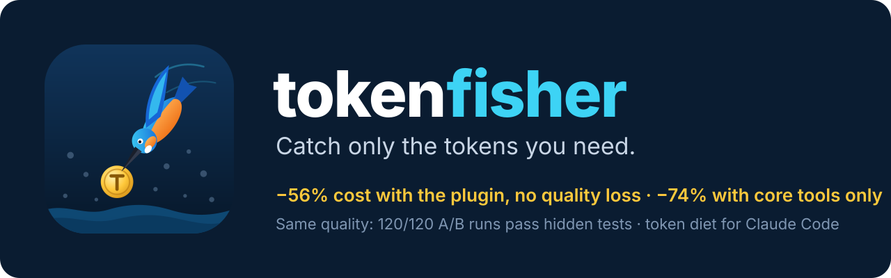

<p align="center">
  
</p>

<p align="center">
  <a href="LICENSE"></a>
  
  
  
  <a href="README.vi.md"></a>
</p>

**tokenfisher** cuts what Claude Code spends on tokens without making it worse at the job. It does that by **measuring first**, cutting only what doesn't hurt, and proving it with A/B runs instead of claims.

Like a kingfisher, it waits, watches, and dives for the one fish worth catching.

## Results: same prompts, hidden tests, real cost

**The plugin as installed (0.3.0, zero flags) cost 56.1% less than Claude Code defaults on Opus, with no quality loss:** 9 tasks × 3 repetitions per arm, every run passed every hidden check.

| level | defaults (Opus) | tokenfisher plugin | change |
|---|---|---|---|
| easy | $0.141 | $0.075 | −46.9% |
| medium | $0.146 | $0.081 | −44.4% |
| hard | $0.286 | $0.128 | −55.2% |
| complex | $0.351 | $0.127 | −63.8% |
| **all** | **$0.253** | **$0.111** | **−56.1%** (95% CI −60.1% … −51.8%) |

It keeps every tool and your MCP servers. Sonnet solved every task alone; the Opus escalation agent was never called. Evidence: [`evidence/merged-2026-10-29/`](evidence/merged-2026-10-29/REPORT.md), $9.81 total.

The ladder below shows where the savings come from. 120 headless Claude Code runs: 8 tasks from easy to complex × 5 configurations × 3 repetitions, graded by hidden tests the agent never sees. Each step of the ladder adds one cut to the one before it.

| step | configuration | quality (hidden checks passed) | cost vs baseline (95% CI) |
|---|---|---|---|
| **A** | baseline: Claude Code defaults, Opus, all built-in tools | 100% (24/24 runs) | – |
| **T** | Opus + only the 7 core coding tools + no MCP + lean prompt + output hook | 100% (24/24) | **−31.4%** (−22.0% … −41.6%) |
| **S** | T on Sonnet | 100% (24/24) | **−73.7%** (−69.1% … −78.7%) |
| **L** | S with `--effort low` | 100% (24/24) | **−76.5%** (−72.5% … −80.8%) |
| **M** | the former `tokenfisher-max` profile (S + Opus escalation agent + Haiku scout), zero flags | 100% (24/24) | **−73.6%** (−70.8% … −76.4%) |

By difficulty:

| level | tasks | T vs A | S vs A | L vs A | M vs A |
|---|---|---|---|---|---|
| easy | off-by-one fix; `slugify` with Vietnamese diacritics | −55.5% | −80.8% | −81.9% | −77.3% |
| medium | 243-line failing suite, two bugs in two files, tests frozen | −55.9% | −81.7% | −82.3% | −79.7% |
| hard | root cause from a ~5,000-line log; semver ranges from a spec; a job queue that hangs and reports idle too early | −31.7% | −71.3% | −70.8% | −69.6% |
| complex | reservations with expiry (10 requirements); make an O(n²) report fast with byte-identical output | −13.7% | −71.8% | −80.3% | −76.0% |

What the numbers say, without spin:

- **No quality loss in any of the 120 runs, from easy to complex.** But every configuration scored 100%, so the tasks still don't separate a strong config from a weak one. Read it as "no regression found on these 8 tasks", not "no regression anywhere".
- **Tool schemas were the hidden cost.** About 70% of every request was the schemas of built-in tools a coding task never calls. Keeping only the 7 core tools cut Opus spend by 31%, with no model change.
- **Model routing is the big lever.** Sonnet with the core tools cost 74% less and passed every hidden check, including the three hard and two complex tasks.
- **The Opus escalation in M was never used.** Sonnet solved every task alone, so M cost the same as S. The safety net is wired and verified to load, but it has not yet been shown to trigger or to help.
- **`--effort low` saved a little more (−76.5%) at no measured quality cost** on these tasks.
- **The plugin's default since 0.3.0 sits between A and S.** It runs Sonnet but keeps every tool and your MCP servers: −56.1% instead of S's −73.7%. The gap is the price of not losing any tool.

Evidence (transcript, grade and diff for every run): [`evidence/ladder-2026-10-29/`](evidence/ladder-2026-10-29/REPORT.md). Total spend: $16.55 at list price.

An earlier 60-run eval on the first 5 tasks is in [`evidence/ab-2026-10-28-opus/`](evidence/ab-2026-10-28-opus/REPORT.md). It was run under the working name `token-diet`.

- With the plugin and no MCP, but all tools and Opus, cost was −14.5%. That configuration was +13.5% on the complex task.
- With Sonnet it was −61.6%.
- In that run the output-compression hook never fired, because the agents limited test output themselves. The hook still pays off on noisy logs: a 500-test log with one failure went from 14.2k to 1.9k characters, and the model still quoted the failing assertion.

## What's inside

| tool | what it does |
|---|---|
| **Sonnet main thread** | The plugin runs the main conversation on Sonnet (`agents/main.md`) and keeps every tool, so MCP servers and web tools still load when you ask for them. Hard work (cross-module design, concurrency/security logic, tricky specs, a bug that survived two attempts) goes to an `opus-architect` subagent; a Haiku `scout` digests big files and logs. A ~120-token policy at session start asks for locating before reading and batching tool calls. Start a session with `claude --model opus` when you want Opus as the main model. |
| **`token-report`** | Reads your Claude Code transcripts and shows where tokens went: input vs cache write vs cache read vs output, by model, by project, main vs subagents. It also shows the **rent** each tool result pays by staying in context, cache rebuilds, and long sessions, with concrete suggestions. `--simulate` replays the compression filter over your past shell output to estimate its savings for *your* workload. `--month 2026-10` totals a calendar month by account (claude.ai login, API key or `CLAUDE_CODE_OAUTH_TOKEN`, as a short hash; recorded from 0.4.0 on), source (desktop, CLI, SDK, IDE), model, level and project. `--compare 2026-10-30` puts the week before a date next to the week after, per request and per session. |
| **`token-audit`** | Breaks down what every session loads before your first prompt (system prompt, skill and agent listings, MCP tool names and instructions, hook output, CLAUDE.md/memory). It traces each entry to the file or plugin it came from and ranks what you can remove. |
| **squash hook** | A `PostToolUse` hook for `Bash` and `PowerShell`. The command runs untouched (permissions, cwd and exit code unchanged); only what Claude *reads* is compressed, and the full output is saved to disk so Claude can read it back. |
| **session warning** | A `UserPromptSubmit` hook. When the context passes 80k tokens (then every +40k), or your prompt arrives after the prompt cache expired (5 min, or 1h when the session uses the 1h TTL), it tells you and Claude once: every tool result is re-billed on each later turn, so `/compact`, or `/clear` when switching tasks. It reads only the tail of the transcript. Set the threshold with `TOKENFISHER_WARN_TOKENS` (`0` turns it off). |
| **A/B eval** | The harness behind the numbers above: fixed prompts, fresh repos, hidden graders, a grader self-test, paired bootstrap CIs and per-run evidence. Bring your own tasks. |

## Install

In Claude Code:

```
/plugin marketplace add Caoquyen1913/tokenfisher
/plugin install tokenfisher@tokenfisher
```

Third-party marketplaces don't auto-update by default. Turn it on in `/plugin` → Marketplaces → `tokenfisher`, or update by hand:

```
/plugin marketplace update tokenfisher
```

Once a day, at session start, the plugin also checks the version on GitHub and tells you when a newer one is out. Turn that off with `TOKENFISHER_NO_UPDATE_CHECK=1`.

After install, new sessions run on Sonnet with every tool. For one session on Opus:

```bash
claude --model opus
```

Setting `"model"` in `settings.json` does not override the plugin's main agent; the `--model` flag does.

**In the Claude desktop app, the model picker wins.** The app starts every Code session with the model chosen in its picker, so the plugin can't switch it to Sonnet there. Pick Sonnet in the picker to get the savings; the hooks, policy and subagents work either way.

### Levels

`/tokenfisher:set <level>` switches how hard tokenfisher saves, for every project (it writes `~/.claude/settings.json` at user scope). It shows the changes first, applies them only on a yes, never overwrites a value you set yourself, and backs the file up. `/tokenfisher:set` shows the current level; `/tokenfisher:set off` removes everything it wrote.

| level | main thread | tools | effort | compact at | warn at | cost vs Opus defaults (95% CI) |
|---|---|---|---|---|---|---|
| low | your model | all | default | not set | 120k | +1.6% (−6.5% … +8.4%) |
| **high** (default) | Sonnet | all | default | 200k | 80k | **−53.4%** (−58.3% … −48.1%) |
| ultra | Sonnet | all | low | 150k | 60k | **−56.4%** (−60.7% … −51.8%) |
| promax | Sonnet | 7 core tools, no MCP or web | low | 100k | 50k | **−72.6%** (−75.3% … −69.7%) |

From high up, subagents run on Sonnet (`CLAUDE_CODE_SUBAGENT_MODEL`) and the session policy asks for Haiku when a subagent only locates code or digests logs. ultra and promax also compress shell output harder. Measured on 9 tasks × 3 runs per level, every run passed every hidden check: [`evidence/levels-2026-10-30/`](evidence/levels-2026-10-30/REPORT.md). low costs about the same as the defaults because it keeps Opus; it is for people who want the warnings and reports without a model change. Compaction never triggered in these runs (the tasks stay under 100k), so the compact settings are not measured yet.

The cheapest measured setup (arm S) also drops every tool except the 7 core coding tools, at the price of MCP and web tools in that session:

```bash
claude --model sonnet --tools Bash,PowerShell,Read,Edit,Write,Glob,Grep --strict-mcp-config
```

Or try tokenfisher for one session from a clone:

```bash
git clone https://github.com/Caoquyen1913/tokenfisher.git
```

```bash
claude --plugin-dir ./tokenfisher
```

Requires Node 18+, no npm dependencies. Tested on Windows 11 (Git Bash and PowerShell) and macOS. Linux should work, but it is not verified yet.

## Use

Ask Claude "where did my tokens go?" or run `/tokenfisher:tokenfisher`. Or run the scripts directly from a clone:

```bash
node bin/token-report.js --days 7 --simulate
```

```bash
node bin/token-audit.js
```

Example audit output (desktop app session, 74.9k startup tokens):

```
component                                       tokens  share  you control
Tool schemas (remainder, not in transcript)      56.5k  75.5%
System prompt                                     7.6k  10.1%
Skill listing                                     6.2k   8.3%
  claude.ai skills (synced to your account) (13)  1.9k   2.5%  yes
  ~/.claude/commands/gsd/ (57)                    1.2k   1.7%  yes
Agent listing                                     2.4k   3.2%
  ~/.claude/agents/gsd-* (18)                     1.0k   1.3%  yes
...
You control ≈ 7.1k of 74.9k startup tokens (10%); the rest is Claude Code itself.
```

## How the hook stays safe

Each command is classified (`lib/squash.js`):

| class | commands | treatment |
|---|---|---|
| `pass` | any pipeline segment that *views content* (`cat`, `sed -n`, `head`, `tail`, `jq`, `Get-Content`…), `git diff/show/blame`, JSON output, or a trailing `# no-squash` | untouched, byte for byte |
| `full` | noisy families: npm/pnpm/yarn/npx, pip/uv/poetry, pytest/jest/vitest, `node …test…`, cargo/go/dotnet/mvn/gradle, make, tsc/eslint/ruff/mypy, docker build/logs, terraform, `git log/status/pull/clone…` | clean + truncate |
| `clean` | everything else | clean only: **never drops a content line** |

- **Clean** strips ANSI codes, keeps only the last redraw of `\r` progress lines, drops progress bars, and collapses repeated lines into `(previous line repeated N more times)`.
- **Truncate** applies only to `full` output over 60 lines or 6,000 characters. It keeps the first 15 lines, the last 40, and every error/warning-looking line with ±2 lines of context. It then appends `[tokenfisher: N lines omitted; full output saved at …]`.
- Output under 1,500 characters is never touched. Any hook error lets the original output through.
- Raw output goes to `~/.claude/tokenfisher/raw/` (newest 300 kept). Inline credentials such as `PASSWORD=…` are masked before anything is written.
- Turn it off with `TOKENFISHER_DISABLE=1`.

## Findings worth knowing

These were measured while building the eval:

- **About 70% of each request was tool schemas.** In a headless session, the prefix with all built-in tools was 35.6k tokens on Sonnet; with only the 7 core coding tools (`--tools`) it was 11.2k.
- **A warm cache skews comparisons.** On the first try, the baseline looked 3× cheaper only because its prompt prefix matched everyday sessions already in cache. The runner now warms every arm first and shuffles arm order.
- **`--strict-mcp-config` shrank the startup prefix from 40.8k to 35.2k tokens** in a headless session with claude.ai connectors.
- **`--disable-slash-commands` *grew* it to 47.1k (+6.3k).** Don't use it to save tokens.
- **Startup context is mostly fixed.** In a desktop-app session about 75% of the 75k startup tokens were tool schemas; the part you control was ~10%.
- **On one real 30-day history, cache reads were 61% of weighted cost**, cache writes 30% and output 9%. Long sessions and idle gaps (cache rebuilds were 18.6%) matter more than verbose answers.
- **Sending codebase exploration to the Haiku scout did not pay off.** Task 9 is a ~108-file repo whose prompt gives only the symptom. With an "explore via scout first" policy, M called scout in every run and its main-thread cache writes fell 45%, but the Haiku turns cost more than that saved: $0.065 vs $0.060 per run for S, 5 runs each, all 11/11. Sonnet explores in about 2 turns by batching `git ls-files` and `grep -rn` into one Bash call, so the policy was dropped. The ladder above covers tasks 1–8; task 9 was added later.
- **The Opus advisor (`advisorModel: opus`) was never called and cost 6.5% more.** On the 9 tasks, the plugin with the advisor enabled vs without, 27 runs each, all 100%: Sonnet never consulted Opus, but the advisor's extra prompt raised cost by +6.5% (95% CI +2.5% … +10.4%). No level turns it on. Evidence: [`evidence/advisor-2026-10-30/`](evidence/advisor-2026-10-30/REPORT.md).

## Reproduce or extend the eval

```bash
node eval/selftest.js
```

```bash
node eval/ab.js --arms A,T,S,L,M --tasks all --reps 3 --parallel 3 --budget 5
```

```bash
node eval/report.js eval/results/<run>
```

```bash
node eval/publish.js eval/results/<run>
```

- `selftest` proves each grader discriminates: the untouched repo must fail and the reference solution must score 100%.
- `ab.js` warms each arm, then runs every (task, arm, rep) in a fresh git-initialised temp repo and grades it.
- `publish.js` copies a run into `evidence/` with home paths, account name, emails, connector lists and rate-limit records removed.

To add a task, create `eval/tasks/<n>-<level>-<name>/` with `task.json` (`level`, `prompt`, optional `testsFrozen`), `repo/`, `hidden/checks.js`, a reference `solution/`, and optionally `prepare.js`.

## Contributing

Issues and PRs are welcome, especially:

- new eval tasks hard enough that Sonnet alone sometimes fails, so the Opus escalation can be measured;
- reports from macOS/Linux;
- smarter filters for noisy command families.

Run `npm test` and `node eval/selftest.js` before opening a PR.

## License

[MIT](LICENSE) © 2026 Kawin Tran
